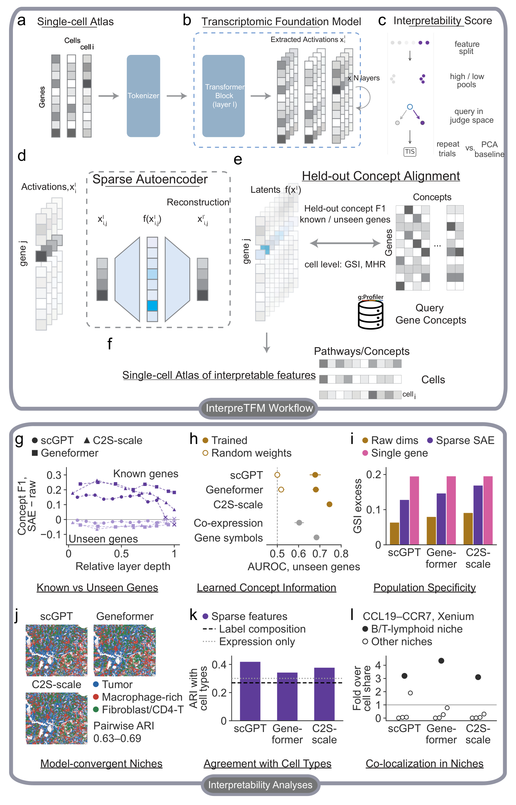

# interpreTFM

Layer-resolved evaluation of transcriptomic foundation models with sparse autoencoders.

[](https://doi.org/10.5281/zenodo.24298819)
[](https://interpretfm.readthedocs.io/en/latest/)
[](https://github.com/maiziezhoulab/interpreTFM/actions/workflows/ci.yml)
[](LICENSE)
[](pyproject.toml)

<p align="center">
  
</p>

**Figure 1.** The interpreTFM workflow: expression profiles are tokenized for a frozen foundation model (a, b), layer activations are scored with the transcriptomic interpretability score (c) and decomposed by a sparse autoencoder (d), features are evaluated by held-out concept alignment and cell-level specificity (e) and projected to cells (f). Panels g–l show the main results on the CosMx lung-cancer section (l, Xenium renal cell carcinoma): concept alignment on known versus unseen genes (g), a linear probe of concept membership for unseen genes against randomly re-initialized models and baselines (h), population specificity (i), niches that converge across models (j) and agree with cell types (k), and ligand–receptor co-localization in niche context (l).

## Overview

interpreTFM is a layer-resolved framework for evaluating what transcriptomic foundation models (scGPT, Geneformer and C2S-Scale) encode, using sparse autoencoders (SAEs), on single-cell and targeted spatial transcriptomic data.
Hidden states are extracted from the frozen models layer by layer, and each evaluated layer is decomposed by its own SAE.
The transcriptomic interpretability score (TIS) asks whether variation along a representation dimension is reflected in the measured transcriptome.
Held-out concept alignment scores features against biological concepts observable on the measured gene panel, with two held-out units (gene-token rows and whole genes), and compares them with raw hidden dimensions and an untrained SAE of the same width.
At the cell level, population specificity (GSI and MHR@100) is compared with that of single genes.
In spatial data, niches built from the features are compared with expression-only baselines, cell-group interfaces are tested with a calibrated statistic and checked for transcript spillover, and a model-free ligand–receptor co-localization screen places candidate pairs in tissue context.
Every measure is meant to be read next to its baseline, so that a feature-level result can be compared with what raw representations or measured expression already provide.

## What is in the repository

- `interpretfm`: the v1 pipeline. One command (`interpretfm run <config.yaml>`) runs every stage from one YAML configuration: input checks, activation extraction in the model's own environment, TIS, SAE training with the λ rule and the untrained control, the concept universe, held-out concept F1, the gene-level readout, feature retention and projection to cells, population specificity, the per-criterion layer table, spatial niches with their baselines, the calibrated interface test, the ligand–receptor co-localization screen and a self-contained HTML report with every metric beside its baseline. The manuscript's six representative layers and its post hoc controls (randomly re-initialized models, the gene-symbol baseline of the gene-level readout) are configurations in `configs/paper/`, with reproduction tests against the published numbers.
- `interp_pipeline`: the analysis package of the manuscript (model adapters, the sharded activation store, TIS, held-out concept alignment, the 0.9 building blocks), which the pipeline builds on.
- `interpretfm hub`: export of trained SAEs to a Hugging Face-ready folder (safetensors, feature table, metrics, model card) and `interpretfm.hub.load_sae` to load them. The SAEs of the manuscript's six layers are published at <https://huggingface.co/YunfeiHu/interpreTFM>.
- A CPU tutorial on a crop of the public CosMx section ([tutorial](https://interpretfm.readthedocs.io/en/latest/tutorials/cosmx_crop.html)).

## Installation

The three foundation models need conflicting software stacks, so each has its own conda environment (Linux x86-64; exported from working CUDA 12 installations):

| Environment | Use | File |
|---|---|---|
| `interpretfm` | analysis, SAE training and evaluation, scGPT extraction | `envs/interpretfm.yml` |
| `geneformer` | Geneformer extraction | `envs/geneformer.yml` |
| `c2s` | C2S-Scale extraction | `envs/c2s.yml` |

```bash
git clone https://github.com/maiziezhoulab/interpreTFM.git
cd interpreTFM
conda env create -f envs/interpretfm.yml
conda activate interpretfm
python -m pip install -e .
```

The package is tested on Python 3.8, 3.9, 3.10 and 3.11 (continuous integration, CPU).
The core environment runs every stage after extraction; the per-model environments (`envs/geneformer.yml`, `envs/c2s.yml`; scGPT extraction needs `python -m pip install --no-deps nnsight==0.4.5` in the core environment) are needed for the `extract` stage only, which the pipeline starts as a child process in the environment named by `model.env`.
Without conda, install PyTorch for your platform first, then `python -m pip install -e ".[models,hub]"`.
Model weights, datasets and activation stores are not distributed with the code; see the [installation guide](https://interpretfm.readthedocs.io/en/latest/installation.html), in particular "Which environment do I need?".

## Quick start

**The pipeline.** Every stage runs from one YAML configuration through the `interpretfm` command; a run is cached and resumable. A complete run on a synthetic dataset with a synthetic activation store takes about a minute on a CPU and ends with the HTML report:

```bash
python -c "from interpretfm.testing import write_toy_run; write_toy_run('example', store=True)"
interpretfm validate example/toy.yaml
interpretfm run example/toy.yaml --dry-run                 # the plan: which stages run, which are cached
interpretfm run example/toy.yaml                           # all stages, then example/runs/toy/13_report/report.html
interpretfm status example/runs/toy
```

Your own data: write a configuration ([configuration reference](https://interpretfm.readthedocs.io/en/latest/pipeline/configuration.html); `dataset.h5ad` with raw counts, `dataset.spatial.um_per_unit` for spatial data, `model.checkpoint` and `model.env` for extraction) and run `interpretfm run my.yaml`. The [tutorial](https://interpretfm.readthedocs.io/en/latest/tutorials/cosmx_crop.html) runs the spatial stages on a crop of the public CosMx section from a published SAE, on a CPU; the manuscript's layers are reproduced with `make repro CONFIG=<name>` from `configs/paper/` ([reproducing the manuscript](https://interpretfm.readthedocs.io/en/latest/reproducing.html)). Trained SAEs are exported with `interpretfm hub export <run_dir> <out_dir>` and loaded with `interpretfm.hub.load_sae`.

See [running a pipeline](https://interpretfm.readthedocs.io/en/latest/pipeline/running.html) for the stages, the stage directories and the `--stages` / `--force` options.

**0.9 analysis package.** The stages run as modules with `python -m`. The commands and snippets below are exercised on toy data by `tests/test_smoke.py`.

Plan the all-layer SAE, QC and held-out F1 jobs for your activation stores (edit the paths in the example first). `--status-only` writes a job manifest and a status table and runs nothing:

```bash
python -m interp_pipeline.layer_experiments.all_layer_sae_f1 --help
python -m interp_pipeline.layer_experiments.all_layer_sae_f1 \
    --model-spec-json configs/model_specs.example.json \
    --out-root runs/demo --status-only
```

Held-out concept alignment of one layer, from Python:

```python
from interp_pipeline.get_annotation.f1_alignment import heldout_report_for_layer

heldout_report_for_layer(
    layer="layer_1.norm2",
    store_root="/path/to/activation_stores/scgpt",  # <store_root>/activations/<layer>/shard_*/
    gt_csv="/path/to/gene_by_concept.csv",          # binary gene x concept matrix
    sae_ckpt_path="/path/to/sae.pt",
    out_dir="runs/f1/scgpt/layer_1.norm2/row_split",
    latent_thresholds=[0.0, 0.15, 0.3, 0.6],
    valid_frac=0.2,
    test_frac=0.1,
    heldout_unit="gene_token_row",                  # "gene_identity" holds out whole genes
    device="cpu",
    # scGPT stores keep vocabulary ids: also pass adata_path=... and scgpt_ckpt=...
)
```

TIS of one layer, with the shuffled-activation control:

```python
import anndata as ad
from interp_pipeline.tis.core import TISConfig, compute_tis_mis_quantile_streamed, shuffle_activations
from interp_pipeline.tis.io import build_judge_matrix, extract_cls_from_shards_aligned

adata = ad.read_h5ad("/path/to/section.h5ad")
A, has_row = extract_cls_from_shards_aligned(
    "/path/to/activation_stores/scgpt/activations/layer_1.norm2", obs_names=adata.obs_names
)
J = build_judge_matrix(adata[has_row], mode="log1p_cp10k")
cfg = TISConfig(K=32, n_trials=800, seed=42)
tis = compute_tis_mis_quantile_streamed(A[has_row], J, q_low=0.25, q_high=0.75, cfg=cfg)
tis_null = compute_tis_mis_quantile_streamed(shuffle_activations(A[has_row]), J, 0.25, 0.75, cfg)
```

The `sae` and `qc` stages of `all_layer_sae_f1` and the TIS layer screen (`interp_pipeline.tis.single_layer_screen`) load backend modules through `--train-script`, `--qc-script` and `--backend-script`; these options have no default (`--status-only` and `--dry-run` work without them). The pipeline's `tis` and `sae` stages are the supported way to run these steps.

## Repository layout

```text
src/interp_pipeline/    analysis package
  adapters/             model and dataset adapters (scGPT, Geneformer, C2S-Scale; AnnData)
  extraction/           layer-resolved activation extraction into sharded stores
  io/                   activation store and plotting style
  tis/                  transcriptomic interpretability score
  sae/                  sparse autoencoder model, trainer and checkpoint normalization
  get_annotation/       concept universe (g:Profiler) and held-out concept alignment
  layer_experiments/    all-layer SAE / QC / F1 runner and result aggregation
  downstream/           cell-level feature tables, niche discovery and interface scoring
  vendor/               adapted third-party model helpers (scGPT, cell2sentence)
plot/                   plotting helpers imported by the package (not in the wheel; use an editable install)
configs/                example configuration
envs/                   conda environment files
tests/                  unit and smoke tests (CPU, no data needed)
docs/                   documentation sources (Read the Docs)
```

## Documentation

Documentation is published at <https://interpretfm.readthedocs.io>. It covers installation, the measures, data formats, usage, evaluation best practices, the roadmap and the API reference. To build it locally:

```bash
python -m pip install -r docs/requirements.txt
sphinx-build -b html docs docs/_build/html
```

## Citation

The manuscript describing interpreTFM is not yet published. Until it is, please cite the software ([`CITATION.cff`](CITATION.cff); GitHub's "Cite this repository" uses it):

```bibtex
@software{interpretfm,
  author  = {Hu, Yunfei},
  title   = {{interpreTFM}: layer-resolved evaluation of transcriptomic foundation models},
  version = {1.0.0},
  year    = {2026},
  doi     = {10.5281/zenodo.24298819},
  url     = {https://github.com/maiziezhoulab/interpreTFM}
}
```

## License

interpreTFM is released under the GNU General Public License v3.0 or later ([`LICENSE`](LICENSE)). Adapted third-party code keeps its original license; see [`THIRD_PARTY_NOTICES.md`](THIRD_PARTY_NOTICES.md).

## Contact

Please use [GitHub issues](https://github.com/maiziezhoulab/interpreTFM/issues) for questions and bug reports, and see [`CONTRIBUTING.md`](CONTRIBUTING.md) for contributions.

## Acknowledgements

interpreTFM builds on scGPT, Geneformer, C2S-Scale and cell2sentence, g:Profiler, and the scverse ecosystem; we thank their developers.
