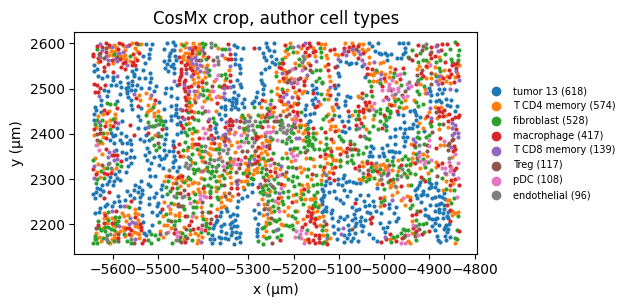
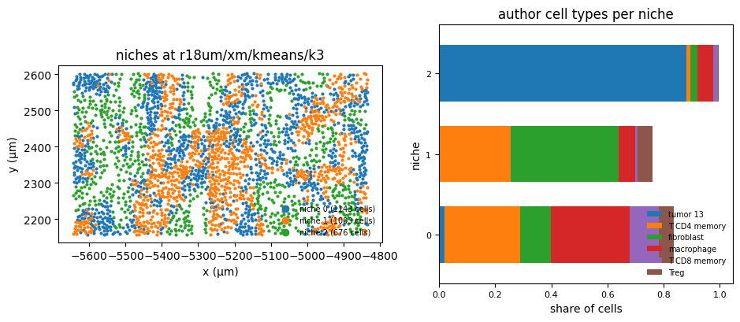

# Tutorial: from a published SAE to a spatial report (CPU)

This notebook runs the spatial stages of the interpreTFM pipeline on a small crop of the public CosMx human lung cancer section (NSCLC, section 8; about 2,800 cells of a 4,500 × 4,500 px = 810 × 810 µm window), starting from the scGPT `layer_1.norm2` sparse autoencoder (SAE) of the manuscript and the retained features already projected to these cells. No GPU and no foundation-model weights are needed; everything runs on a CPU in a few minutes. It shows

1. what the SAE export contains and how it is loaded (`interpretfm.hub`);
2. what the `cells` stage computes (features projected to cells), checked on a slice of the activation store;
3. the stages `niches → interfaces → lr_screen → report` from one configuration file, and how to read the report.

A last, optional section shows how activations are extracted from scGPT on a GPU.

The data come as one bundle from either a local folder or the Hugging Face repository of the release (`SOURCE` below). On Colab, run the next cell first to install the package.


```python
import importlib.util, subprocess, sys

ON_COLAB = importlib.util.find_spec("google.colab") is not None
if ON_COLAB:  # a plain CPU install: PyTorch from the CPU index, then the package with the hub extra
    subprocess.run([sys.executable, "-m", "pip", "install", "-q", "torch", "--index-url", "https://download.pytorch.org/whl/cpu"], check=True)
    subprocess.run([sys.executable, "-m", "pip", "install", "-q", "interpretfm[hub] @ git+https://github.com/OliiverHu/interpreTFM.git"], check=True)
```

## 1. The data bundle and the SAE

`interpretfm.hub.tutorial_bundle` returns the root folder of the bundle. With `SOURCE = "local"` it is the folder `BUNDLE` (the bundle of the release, downloaded by hand or built from the run directories); with `SOURCE = "hub"` the files are fetched from the Hugging Face repository `REPO_ID` (the placeholder is replaced by the published repository id).


```python
import os
from pathlib import Path

import anndata as ad
import matplotlib.pyplot as plt
import numpy as np
import pandas as pd
import yaml

from interpretfm import hub

SOURCE = "local"                                       # "local" or "hub"
BUNDLE = os.environ.get("INTERPRETFM_TUTORIAL_BUNDLE", "interpretfm_tutorial_bundle")
REPO_ID = hub.DEFAULT_REPO                             # "<hf-user>/interpretfm-v1" until the release is published
MODEL, LAYER, DATASET = "scgpt", "layer_1.norm2", "cosmx"

root = hub.tutorial_bundle(SOURCE, path=BUNDLE, repo_id=REPO_ID)
sorted(p.relative_to(root).as_posix() for p in root.rglob("*") if p.is_file())
```


    ['scgpt/cosmx/layer_1.norm2/README.md',
     'scgpt/cosmx/layer_1.norm2/config.json',
     'scgpt/cosmx/layer_1.norm2/features.csv',
     'scgpt/cosmx/layer_1.norm2/metrics.json',
     'scgpt/cosmx/layer_1.norm2/sae.safetensors',
     'tutorial/README.md',
     'tutorial/cells_layer_1.norm2.h5ad',
     'tutorial/cosmx_author_groups.csv',
     'tutorial/cosmx_crop.h5ad',
     'tutorial/store/activations/layer_1.norm2/shard_0/activations.pt',
     'tutorial/store/activations/layer_1.norm2/shard_0/index.pt',
     'tutorial/store/activations/layer_1.norm2/shard_0/metadata.json']


```python
crop = ad.read_h5ad(root / "tutorial" / "cosmx_crop.h5ad")
print(crop)
print("raw counts:", crop.X[:3].sum(1).A.ravel(), "| µm per pixel:", crop.uns["interpretfm_tutorial"]["um_per_unit"])
crop.obs["author_cell_type"].value_counts().head(8)
```

    AnnData object with n_obs × n_vars = 2822 × 960
        obs: 'author_cell_type', 'Width', 'Height', 'cell_ID', 'niche'
        var: 'feature_name'
        uns: 'interpretfm_tutorial'
        obsm: 'spatial'
    raw counts: [ 91.  34. 526.] | µm per pixel: 0.18


    author_cell_type
    tumor 13        618
    T CD4 memory    574
    fibroblast      528
    macrophage      417
    T CD8 memory    139
    Treg            117
    pDC             108
    endothelial      96
    Name: count, dtype: int64


```python
xy = crop.obsm["spatial"] * 0.18
types = crop.obs["author_cell_type"].astype(str)
top = types.value_counts().index[:8]
fig, ax = plt.subplots(figsize=(5.2, 4.6), dpi=100)
for t in top:
    m = (types == t).values
    ax.scatter(xy[m, 0], xy[m, 1], s=4, label=f"{t} ({m.sum()})")
ax.set_aspect("equal"); ax.set_xlabel("x (µm)"); ax.set_ylabel("y (µm)"); ax.set_title("CosMx crop, author cell types")
ax.legend(fontsize=7, markerscale=3, loc="center left", bbox_to_anchor=(1.0, 0.5), frameon=False)
plt.show()
```


    

    


### The exported SAE

`hub.load_sae` returns a checkpoint dict (`state_dict`, `d_in`, `n_latents`, `input_scale`, the training `spec`) that `interpretfm.sae.Encoder` accepts; the folder also holds the retained feature–concept table and the metrics of the layer beside their baselines.


```python
from interpretfm.sae import Encoder

ckpt = hub.load_sae(root, MODEL, LAYER, dataset=DATASET)
encoder = Encoder(ckpt)
print(f"{ckpt['architecture']}: d_in {ckpt['d_in']}, n_latents {ckpt['n_latents']}, input_scale {ckpt['input_scale']:.4f}, spec {ckpt['spec']}")

metrics = pd.read_json(hub.layer_dir(root, MODEL, LAYER, dataset=DATASET) / "metrics.json", typ="series")
f1 = pd.DataFrame(metrics["concept_f1"]).T[["unit", "representation", "n_concepts", "concept_f1"]]
f1.pivot(index="unit", columns="representation", values="concept_f1").round(3)
```

    relu_sae_with_biases_raw_space: d_in 512, n_latents 4096, input_scale 1.0966, spec {'n_latents': 4096, 'l1': 1.0, 'lr': 0.0001, 'steps': 8000, 'warmup_steps': 1000, 'resample_steps': 2000, 'seed': 0}


<div>
<style scoped>
    .dataframe tbody tr th:only-of-type {
        vertical-align: middle;
    }

    .dataframe tbody tr th {
        vertical-align: top;
    }

    .dataframe thead th {
        text-align: right;
    }
</style>
<table border="1" class="dataframe">
  <thead>
    <tr style="text-align: right;">
      <th>representation</th>
      <th>raw</th>
      <th>sae</th>
      <th>untrained</th>
    </tr>
    <tr>
      <th>unit</th>
      <th></th>
      <th></th>
      <th></th>
    </tr>
  </thead>
  <tbody>
    <tr>
      <th>gene</th>
      <td>0.032936</td>
      <td>0.020526</td>
      <td>0.026598</td>
    </tr>
    <tr>
      <th>row</th>
      <td>0.174756</td>
      <td>0.338896</td>
      <td>0.229746</td>
    </tr>
  </tbody>
</table>
</div>


```python
features = hub.load_features(root, MODEL, LAYER, dataset=DATASET)
print(len(features), "retained features;", features["concept"].nunique(), "concepts; mean test F1", round(features["test_f1"].mean(), 3))
features.sort_values("test_f1", ascending=False).head(8)[["feature", "concept", "term_name", "n_panel_genes", "valid_f1", "test_f1"]]
```

    194 retained features; 194 concepts; mean test F1 0.487


<div>
<style scoped>
    .dataframe tbody tr th:only-of-type {
        vertical-align: middle;
    }

    .dataframe tbody tr th {
        vertical-align: top;
    }

    .dataframe thead th {
        text-align: right;
    }
</style>
<table border="1" class="dataframe">
  <thead>
    <tr style="text-align: right;">
      <th></th>
      <th>feature</th>
      <th>concept</th>
      <th>term_name</th>
      <th>n_panel_genes</th>
      <th>valid_f1</th>
      <th>test_f1</th>
    </tr>
  </thead>
  <tbody>
    <tr>
      <th>0</th>
      <td>689</td>
      <td>GO:0019885</td>
      <td>GO:0019885</td>
      <td>8</td>
      <td>0.790531</td>
      <td>0.788033</td>
    </tr>
    <tr>
      <th>2</th>
      <td>3014</td>
      <td>GO:0051140</td>
      <td>GO:0051140</td>
      <td>5</td>
      <td>0.731204</td>
      <td>0.731328</td>
    </tr>
    <tr>
      <th>1</th>
      <td>271</td>
      <td>GO:0051082</td>
      <td>GO:0051082</td>
      <td>12</td>
      <td>0.731388</td>
      <td>0.731035</td>
    </tr>
    <tr>
      <th>3</th>
      <td>1269</td>
      <td>GO:1900118</td>
      <td>GO:1900118</td>
      <td>5</td>
      <td>0.730351</td>
      <td>0.724211</td>
    </tr>
    <tr>
      <th>4</th>
      <td>2297</td>
      <td>GO:0042613</td>
      <td>GO:0042613</td>
      <td>8</td>
      <td>0.715848</td>
      <td>0.716821</td>
    </tr>
    <tr>
      <th>5</th>
      <td>1047</td>
      <td>GO:0021879</td>
      <td>GO:0021879</td>
      <td>9</td>
      <td>0.685001</td>
      <td>0.682681</td>
    </tr>
    <tr>
      <th>6</th>
      <td>630</td>
      <td>GO:0032305</td>
      <td>GO:0032305</td>
      <td>5</td>
      <td>0.676073</td>
      <td>0.681183</td>
    </tr>
    <tr>
      <th>8</th>
      <td>3876</td>
      <td>GO:0033194</td>
      <td>GO:0033194</td>
      <td>5</td>
      <td>0.663226</td>
      <td>0.672831</td>
    </tr>
  </tbody>
</table>
</div>


## 2. What the `cells` stage computes

The `cells` stage reads the activation store (one row of hidden states per gene token of every cell), encodes every row with the SAE, and averages the retained features over the gene tokens of each cell. The bundle holds one shard of the store restricted to 80 cells of the crop, and `tutorial/cells_layer_1.norm2.h5ad` holds the features of all crop cells as the manuscript run projected them over the whole section. The same function the stage uses reproduces those values.


```python
from interpretfm.cells import accumulate_cell_profiles

store = root / "tutorial" / "store"
cells_pub = ad.read_h5ad(root / "tutorial" / "cells_layer_1.norm2.h5ad")
fidx = cells_pub.var["feature"].astype(int).tolist()
prof = accumulate_cell_profiles(store, LAYER, encoder, [str(o) for o in crop.obs_names], special_tokens=["60694", "60695"],
                                feature_idx=fidx, batch_size=4096)
ours = pd.DataFrame(prof.sae, index=crop.obs_names[prof.cell_index], columns=cells_pub.var_names)
theirs = cells_pub[ours.index].to_df()
print(f"{len(ours)} cells, {ours.shape[1]} features; gene tokens per cell: median {int(np.median(prof.counts))};",
      f"max |difference| to the published projection: {np.abs(ours.values - theirs.values).max():.2e}")
ours.iloc[:4, :5].round(3)
```

    80 cells, 194 features; gene tokens per cell: median 70; max |difference| to the published projection: 0.00e+00


<div>
<style scoped>
    .dataframe tbody tr th:only-of-type {
        vertical-align: middle;
    }

    .dataframe tbody tr th {
        vertical-align: top;
    }

    .dataframe thead th {
        text-align: right;
    }
</style>
<table border="1" class="dataframe">
  <thead>
    <tr style="text-align: right;">
      <th>var_name</th>
      <th>GO:0019885|feat689</th>
      <th>GO:0051082|feat271</th>
      <th>GO:0051140|feat3014</th>
      <th>GO:1900118|feat1269</th>
      <th>GO:0042613|feat2297</th>
    </tr>
  </thead>
  <tbody>
    <tr>
      <th>1550_18-7</th>
      <td>0.165</td>
      <td>0.102</td>
      <td>0.0</td>
      <td>0.000</td>
      <td>0.216</td>
    </tr>
    <tr>
      <th>1551_18-7</th>
      <td>0.014</td>
      <td>0.084</td>
      <td>0.0</td>
      <td>0.008</td>
      <td>0.009</td>
    </tr>
    <tr>
      <th>1552_18-7</th>
      <td>0.203</td>
      <td>0.001</td>
      <td>0.0</td>
      <td>0.000</td>
      <td>0.213</td>
    </tr>
    <tr>
      <th>1553_18-7</th>
      <td>0.118</td>
      <td>0.042</td>
      <td>0.0</td>
      <td>0.000</td>
      <td>0.090</td>
    </tr>
  </tbody>
</table>
</div>


## 3. Niches, interfaces, ligand–receptor screen and the report

One YAML configuration drives the pipeline. Here the projected features replace the model-level stages: `cells_h5ad` points `niches` and `interfaces` at the published features (so `extract`, `sae` and `cells` need not run), and `report: {spatial_only: true}` builds the report from the spatial stages alone. The settings follow the manuscript's CosMx configuration (radii in µm, three niches at 18 µm, the calibrated interface test on the author labels grouped as in the paper, the screen at 18 µm) with fewer permutations and seeds so that the notebook runs in minutes. Paths are relative to the configuration file.


```python
run_root = Path("tutorial_run")
run_root.mkdir(exist_ok=True)
rel = lambda p: os.path.relpath(p, run_root)
config = {
    "run": {"name": "cosmx_crop", "out_dir": "runs/cosmx_crop", "seed": 0},
    "dataset": {"h5ad": rel(root / "tutorial/cosmx_crop.h5ad"), "counts_layer": None,
                "gene_id": {"column": "index", "kind": "ensembl"},
                "labels": {"column": "author_cell_type", "groups": rel(root / "tutorial/cosmx_author_groups.csv")},
                "spatial": {"obsm": "spatial", "um_per_unit": 0.18}, "qc": {"min_transcripts": 0, "min_genes": 0}},
    "model": {"name": MODEL, "checkpoint": None, "env": {}, "layers": [LAYER], "representative_layer": LAYER,
              "cell_pooling": {"kind": "token", "token": "60695"}, "special_tokens": ["60694", "60695"]},
    "stages": {
        "niches": {"cells_h5ad": {LAYER: rel(root / "tutorial/cells_layer_1.norm2.h5ad")},
                   "radii_um": [18.0, 21.6, 27.0], "k": [3, 4, 5], "methods": ["kmeans", "gmm"], "spaces": ["m", "xm"],
                   "seeds": [0, 1], "min_cluster": 50, "n_pcs": 50, "n_null": 5,
                   "baselines": ["expression_svd50", "label_composition"],
                   "label_composition": {"radius_um": 21.6, "k": 3, "n_pcs": 15, "n_init": 10, "seed": 0},
                   "seed_stability": {"k": [4, 5]}, "concepts": {"top_k": 25, "min_cells": 20},
                   "fixed_configs": [{"radius_um": 18.0, "space": "xm", "method": "kmeans", "k": 3}]},
        "interfaces": {"cells_h5ad": {LAYER: rel(root / "tutorial/cells_layer_1.norm2.h5ad")},
                       "edge_radius_um": 21.6, "block_um": 21.6, "legacy_tile_um": 72.0, "length_scales_um": [10.8, 27.0, 72.0],
                       "n_perm": 50, "calib_perm": 20, "calib_reps": 2, "legacy_perm": 10, "min_edges": 20,
                       "exclude_groups": ["low_quality", "unresolved"], "covariates": {"area": {"product": ["Width", "Height"]}},
                       "niche": {"config": "r18um/xm/kmeans/k3"}, "markers": {"enabled": True, "top_n": 10},
                       "fired_on": {"enabled": False}},
        "lr_screen": {"radius_um": 18.0, "thresholds": [1, 3], "n_perm": 100, "seed": 7, "min_positive": 30,
                      "q_max": 0.05, "fold_min": 1.2, "niche": {"config": "r18um/xm/kmeans/k3"}},
        "report": {"spatial_only": True},
    },
    "output": {"html": True, "json": True},
}
cfg_path = run_root / "cosmx_crop.yaml"
cfg_path.write_text(yaml.safe_dump(config, sort_keys=False))
print(cfg_path.read_text()[:600], "...")
```

    run:
      name: cosmx_crop
      out_dir: runs/cosmx_crop
      seed: 0
    dataset:
      h5ad: ../../../runs/tutorial_bundle/tutorial/cosmx_crop.h5ad
      counts_layer: null
      gene_id:
        column: index
        kind: ensembl
      labels:
        column: author_cell_type
        groups: ../../../runs/tutorial_bundle/tutorial/cosmx_author_groups.csv
      spatial:
        obsm: spatial
        um_per_unit: 0.18
      qc:
        min_transcripts: 0
        min_genes: 0
    model:
      name: scgpt
      checkpoint: null
      env: {}
      layers:
      - layer_1.norm2
      representative_layer: layer_1.norm2
      cell_pooling:
        kind: token
        token: '60695'
      special_tokens:
      - ...


`interpretfm validate` checks the configuration and the files it names; `interpretfm run --stages ...` runs the stages in order, caching each one in the run directory (a second call skips finished stages). The same commands work from a shell: `interpretfm validate tutorial_run/cosmx_crop.yaml` and `interpretfm run tutorial_run/cosmx_crop.yaml --stages ingest,niches,interfaces,lr_screen,report`.


```python
import logging, time

from interpretfm.cli import main

logging.getLogger().handlers.clear()
assert main(["validate", str(cfg_path)]) == 0
t0 = time.time()
assert main(["run", str(cfg_path), "--stages", "ingest,niches,interfaces,lr_screen,report"]) == 0
print(f"finished in {time.time() - t0:.0f} s")
main(["status", str(run_root / "runs/cosmx_crop")])
```

    INFO run cosmx_crop in tutorial_run/runs/cosmx_crop (5 stages)


    INFO stage ingest: start (tutorial_run/runs/cosmx_crop/01_ingest)


    INFO ingest: reading interpretfm_tutorial_bundle/tutorial/cosmx_crop.h5ad


    WARNING ingest: vocabulary coverage not computed: no vocabulary given (set model.vocab to the model's gene vocabulary JSON)


    INFO stage ingest: done in 0.0 s


    INFO stage niches: start (tutorial_run/runs/cosmx_crop/10_niches)


    INFO niches: radii [18.0, 21.6, 27.0] µm = [100.0, 120.0, 150.0] native units (0.18 µm per unit); 36 configurations per sweep


    INFO niches: layer_1.norm2: 2822 cells with features x 194 features from interpretfm_tutorial_bundle/tutorial/cells_layer_1.norm2.h5ad


    OK: tutorial_run/cosmx_crop.yaml
      run: cosmx_crop -> tutorial_run/runs/cosmx_crop
      dataset: interpretfm_tutorial_bundle/tutorial/cosmx_crop.h5ad [spatial]
      model: scgpt, 1 layer(s), env: current


    INFO niches: layer_1.norm2: selected r21.6um/m/kmeans/k3 (r120 native) (score 3.934, rank 1/36): seed ARI 0.994, purity 0.797 (null 0.543, z 121.4), ARI 0.189 / NMI 0.250 vs author_cell_type


    INFO niches: layer_1.norm2: fixed configuration r18um/xm/kmeans/k3 (r100 native): rank 9, seed ARI 0.9505, purity 0.782 (null 0.552, z 89.5), ARI 0.251 / NMI 0.311


    INFO niches: layer_1.norm2: expression-only winner r18um/m/gmm/k3 (r100 native): ARI 0.118 / NMI 0.159


    INFO niches: layer_1.norm2: expression-only at r21.6um/m/kmeans/k3 (r120 native): ARI 0.104 / NMI 0.132


    INFO niches: layer_1.norm2: label composition (published, r 21.6 µm, k 3): ARI 0.173 / NMI 0.232


    INFO niches: layer_1.norm2: label composition (at_model_config, r 21.6 µm, k 3): ARI 0.173 / NMI 0.232


    INFO stage niches: done in 108.0 s


    INFO stage interfaces: start (tutorial_run/runs/cosmx_crop/11_interfaces)


    INFO interfaces: edge radius 21.6 µm = 120 native units, block 120, legacy tile 400, length scales [60.0, 150.0, 400.0] (native); 15 groups from 18 labels; covariates ['log_counts', 'log_genes', 'log_area']


    INFO interfaces: partner markers: top 10 per label for 17 labels, 15 groups


    INFO interfaces: layer_1.norm2: 2822 cells x 194 features, niche partition 'niche_at_r18um/xm/kmeans/k3' (3 niches)


    INFO interfaces: layer_1.norm2: 65 niche pairs (|z|>2: tile 13.8 %, calibrated 1.5 %; {'not supported': 64, 'depleted': 1}; z* 2.045), 58 niche-free pairs ({'not supported': 56, 'depleted': 2}; z* 2.139); FPR smooth v1 10.3 % / v2 5.7 %, noise 6.2 %; neighbour corr P 0.247, P_adj 0.060


    INFO stage interfaces: done in 1.0 s


    INFO stage lr_screen: start (tutorial_run/runs/cosmx_crop/12_lr_screen)


    INFO lr_screen: 2822 cells, 18 labels; 3233 database rows -> 397 pairs on the panel (338 complexes known); radius 100 native units = 18 µm (radius_um), mean other cells within the radius 8.135; thresholds [1, 3], 100 permutations, seed 7


    INFO lr_screen: pair 0 / 397 (TGFB1_TGFBR1_TGFBR2)


    INFO lr_screen: pair 50 / 397 (WNT11_FZD4)


    INFO lr_screen: pair 100 / 397 (CCL15_CCR1)


    INFO lr_screen: pair 150 / 397 (MIF_CD74_CD44)


    INFO lr_screen: pair 200 / 397 (SPP1_ITGA9_ITGB1)


    INFO lr_screen: pair 250 / 397 (COL6A2_ITGA3_ITGB1)


    INFO lr_screen: pair 300 / 397 (ENTPD1_ADORA2A)


    INFO lr_screen: pair 350 / 397 (ICOSL_CTLA4)


    INFO lr_screen: tested {'1': 364, '3': 14}; hits {'1': 3, '3': 3}; robust 0 (); depleted 0


    INFO lr_screen: layer_1.norm2: placement of 3 pairs over 3 niches ('niche_at_r18um/xm/kmeans/k3', 2822 of 2822 cells labelled)


    INFO stage lr_screen: done in 2.0 s


    INFO stage report: start (tutorial_run/runs/cosmx_crop/13_report)


    INFO report: tutorial_run/runs/cosmx_crop/13_report/report.json and tutorial_run/runs/cosmx_crop/13_report/report.html


    INFO report: spatial: niches: run; interfaces: run; lr_screen: run


    INFO stage report: done in 0.0 s


    stage       env    action        reason
    ingest      core   done          no valid cached result
    niches      core   done          no valid cached result
    interfaces  core   done          no valid cached result
    lr_screen   core   done          no valid cached result
    report      core   done          no valid cached result
    finished in 111 s
    stage      status   duration_s  started                    error
    ingest     done            0.0  2026-11-06T17:24:51+00:00  
    extract    -                                               
    tis        -                                               
    sae        -                                               
    concepts   -                                               
    concept_eval -                                               
    gene_readout -                                               
    cells      -                                               
    layers     -                                               
    niches     done          108.0  2026-11-06T17:24:51+00:00  
    interfaces done            1.0  2026-11-06T17:26:39+00:00  
    lr_screen  done            2.0  2026-11-06T17:26:40+00:00  
    report     done            0.0  2026-11-06T17:26:42+00:00  


    0


### Reading the report

`13_report/report.json` holds every number beside its baseline; `13_report/report.html` is the same as one self-contained page. Each section carries a note on what it measures and what it does not (`section_notes`).


```python
import json

run_dir = run_root / "runs/cosmx_crop"
report = json.load(open(run_dir / "13_report/report.json"))
for section in ("niches", "interfaces", "lr_screen"):
    print(f"[{section}] {report['section_notes'][section]}\n")
```

    [niches] ARI and NMI measure agreement of the niche partition with the dataset labels; purity is the fraction of a cell's neighbours sharing its niche, read against the tile-shuffle null (its z). The expression-only partition at its own winner and at the model's configuration, and the label-composition partition, are the baselines: a niche partition is only informative beyond expression when it is read next to them. Seed stability is the median seed-to-seed ARI at the finer k; the sweep winner is a configuration choice and a near-tie is possible. The top concepts name what the features detect inside a niche, not a mechanism.
    
    [interfaces] The share of pairs with |z| > 2 is shown under the legacy tile null and under the calibrated within-block null; z* is the call threshold set so that smooth, contact-free fields give about 5 % of |z| > z*. The calibrated null controls the per-pair false-positive rate under smooth contact-free fields (the false-positive shares show how well); it is not a false-discovery rate across pairs, and its power is not evaluated. Calls depend on the niche partition; the niche-free column is the partition-free variant. Effect sizes are in percent of the score.
    
    [lr_screen] Model-free: counts, coordinates and labels only. A hit is a ligand–receptor pair whose number of close (ligand-positive, receptor-positive) cell pairs exceeds the within-type permutation null by fold ≥ 1.2 at q < 0.05; robust = hit at both positivity thresholds. The fold depends on the radius (a larger radius dilutes near-contact co-localization), so hit sets are radius-specific; the mean number of other cells within the radius is given to compare neighbourhood sizes across platforms. The niche placement ratio is the share of a hit's close pairs in a niche over the niche's share of cells (1 = as expected from the niche's size); it describes where the hit lives, not whether the niche causes it. Co-localization is not evidence of signalling.
    


**Niches.** The sweep over radius, clustering method, feature space (`m` = features, `xm` = features with coordinates) and `k` is scored by seed stability (ARI between seeds), purity against a tile-shuffle null and separability; the selected configuration and the manuscript's fixed configuration are both validated. Read the model's ARI/NMI against the author labels next to the expression-only partition (SVD of the counts, same sweep) and the label-composition partition (neighbourhood cell-type composition): a niche partition from SAE features is informative when it tells the labels something the expression-only partition does not, at a seed stability the baselines share.


```python
n = report["niches"][LAYER]
rows = {"SAE features (" + n["config"] + ")": n["model"]}
for name in ("expression_winner", "expression_at_model_config", "label_composition"):
    b = n["baselines"].get(name)
    if b:
        rows[name + (" (" + b["config"] + ")" if b.get("config") else "")] = b
pd.DataFrame(rows).T[["ari", "nmi", "seed_ari", "purity", "purity_null_mean", "purity_z"]].astype(float).round(3)
```


<div>
<style scoped>
    .dataframe tbody tr th:only-of-type {
        vertical-align: middle;
    }

    .dataframe tbody tr th {
        vertical-align: top;
    }

    .dataframe thead th {
        text-align: right;
    }
</style>
<table border="1" class="dataframe">
  <thead>
    <tr style="text-align: right;">
      <th></th>
      <th>ari</th>
      <th>nmi</th>
      <th>seed_ari</th>
      <th>purity</th>
      <th>purity_null_mean</th>
      <th>purity_z</th>
    </tr>
  </thead>
  <tbody>
    <tr>
      <th>SAE features (r21.6um/m/kmeans/k3 (r120 native))</th>
      <td>0.189</td>
      <td>0.250</td>
      <td>0.994</td>
      <td>0.797</td>
      <td>0.543</td>
      <td>121.439</td>
    </tr>
    <tr>
      <th>expression_winner (r18um/m/gmm/k3 (r100 native))</th>
      <td>0.118</td>
      <td>0.159</td>
      <td>0.935</td>
      <td>0.894</td>
      <td>0.684</td>
      <td>42.559</td>
    </tr>
    <tr>
      <th>expression_at_model_config</th>
      <td>0.104</td>
      <td>0.132</td>
      <td>NaN</td>
      <td>0.871</td>
      <td>0.655</td>
      <td>117.816</td>
    </tr>
    <tr>
      <th>label_composition (r21.6um/composition/kmeans/k3 (r120 native))</th>
      <td>0.173</td>
      <td>0.232</td>
      <td>NaN</td>
      <td>NaN</td>
      <td>NaN</td>
      <td>NaN</td>
    </tr>
  </tbody>
</table>
</div>


```python
labels = pd.read_csv(run_dir / "10_niches" / LAYER / "labels.csv", dtype={"cell": str}).set_index("cell")
col = [c for c in labels.columns if c.startswith("niche_at_")][0]
niche = labels[col].reindex(crop.obs_names)
top_concepts = pd.read_csv(run_dir / "10_niches" / LAYER / "top_concepts.csv")
fig, axes = plt.subplots(1, 2, figsize=(9.5, 4.2), dpi=100, gridspec_kw={"width_ratios": [1.1, 1]})
for k in sorted(niche.dropna().unique()):
    m = (niche == k).fillna(False).to_numpy(dtype=bool)
    axes[0].scatter(xy[m, 0], xy[m, 1], s=4, label=f"niche {k} ({m.sum()} cells)")
axes[0].set_aspect("equal"); axes[0].set_title(f"niches at {col.replace('niche_at_', '')}"); axes[0].set_xlabel("x (µm)"); axes[0].set_ylabel("y (µm)")
axes[0].legend(fontsize=7, markerscale=3, frameon=False)
ct = pd.crosstab(niche.dropna().astype(int), types[niche.notna()].values, normalize="index")
ct[ct.sum().sort_values(ascending=False).index[:6]].plot.barh(ax=axes[1], stacked=True, width=0.7, fontsize=8)
axes[1].set_xlabel("share of cells"); axes[1].set_ylabel("niche"); axes[1].legend(fontsize=7, frameon=False, loc="lower right"); axes[1].set_title("author cell types per niche")
fig.tight_layout()
display(fig)
plt.close(fig)
```


    

    


The niche concept labels (`top_concepts.csv`) are the retained concepts whose feature scores are highest inside each niche relative to the rest (Wilcoxon, BH-adjusted), ranked by effect; they describe what the SAE features say about each niche.


```python
top_concepts.groupby("niche").head(3)[["niche", "concept", "term_name", "effect", "qval"]].round(3)
```


<div>
<style scoped>
    .dataframe tbody tr th:only-of-type {
        vertical-align: middle;
    }

    .dataframe tbody tr th {
        vertical-align: top;
    }

    .dataframe thead th {
        text-align: right;
    }
</style>
<table border="1" class="dataframe">
  <thead>
    <tr style="text-align: right;">
      <th></th>
      <th>niche</th>
      <th>concept</th>
      <th>term_name</th>
      <th>effect</th>
      <th>qval</th>
    </tr>
  </thead>
  <tbody>
    <tr>
      <th>0</th>
      <td>0</td>
      <td>REAC:R-HSA-3000178</td>
      <td>REAC:R-HSA-3000178</td>
      <td>0.089</td>
      <td>0.0</td>
    </tr>
    <tr>
      <th>1</th>
      <td>0</td>
      <td>GO:0019885</td>
      <td>GO:0019885</td>
      <td>0.053</td>
      <td>0.0</td>
    </tr>
    <tr>
      <th>2</th>
      <td>0</td>
      <td>REAC:R-HSA-1650814</td>
      <td>REAC:R-HSA-1650814</td>
      <td>0.042</td>
      <td>0.0</td>
    </tr>
    <tr>
      <th>25</th>
      <td>1</td>
      <td>GO:0098553</td>
      <td>GO:0098553</td>
      <td>0.025</td>
      <td>0.0</td>
    </tr>
    <tr>
      <th>26</th>
      <td>1</td>
      <td>GO:0042613</td>
      <td>GO:0042613</td>
      <td>0.012</td>
      <td>0.0</td>
    </tr>
    <tr>
      <th>27</th>
      <td>1</td>
      <td>GO:0002449</td>
      <td>GO:0002449</td>
      <td>0.011</td>
      <td>0.0</td>
    </tr>
    <tr>
      <th>50</th>
      <td>2</td>
      <td>GO:0051082</td>
      <td>GO:0051082</td>
      <td>0.037</td>
      <td>0.0</td>
    </tr>
    <tr>
      <th>51</th>
      <td>2</td>
      <td>GO:0030667</td>
      <td>GO:0030667</td>
      <td>0.012</td>
      <td>0.0</td>
    </tr>
    <tr>
      <th>52</th>
      <td>2</td>
      <td>GO:0061436</td>
      <td>GO:0061436</td>
      <td>0.011</td>
      <td>0.0</td>
    </tr>
  </tbody>
</table>
</div>


**Interfaces.** For every pair of cell groups with enough contact edges, the program score (the mean of the retained features, adjusted within each label for transcript counts, detected genes and cell area) at the interface is compared with a permutation null inside spatial blocks, niches and labels. The share of pairs with |z| > 2 under the legacy tile null is reported beside the share under the calibrated null; the call threshold `z*` is set on contact-free smooth random fields with the same neighbour correlation, and the false-positive rate on those fields is the calibration check. On a crop this small most pairs have few edges, so read the counts, not the identities of the pairs.


```python
i = report["interfaces"][LAYER]
print(f"{i['n_cells']} cells, {i['n_edges']} contact edges at {i['units']['edge_radius']} µm; {i['n_niches']} niches ({i['niche_column']})")
print("pairs tested (niche-stratified / niche-free):", i["n_pairs"])
print("share |z| > 2: legacy tile null", round(i["share_abs_z_gt2"]["legacy_tile"], 3), "| calibrated", round(i["share_abs_z_gt2"]["calibrated"], 3))
print("z*:", {k: round(v, 2) for k, v in i["z_star"].items()}, "| false-positive rate on smooth fields:", {k: round(v, 3) for k, v in i["fpr"].items()})
print("calls:", i["calls"])
pairs = pd.read_csv(run_dir / "11_interfaces" / LAYER / "niche_pairs.csv")
pairs.sort_values("z_v2", key=np.abs, ascending=False).head(6)[["group_a", "group_b", "niche", "n_edges", "z_v1", "z_v2", "effect_pct_v2", "call_v2"]].round(2)
```

    2822 cells, 16672 contact edges at 21.599999999999998 µm; 3 niches (niche_at_r18um/xm/kmeans/k3)
    pairs tested (niche-stratified / niche-free): {'niche': 65, 'free': 58}
    share |z| > 2: legacy tile null 0.138 | calibrated 0.015
    z*: {'niche': 2.04, 'free': 2.14} | false-positive rate on smooth fields: {'smooth_field_legacy': 0.103, 'smooth_field_calibrated': 0.057, 'smooth_field_free': 0.063, 'iid_noise': 0.062}
    calls: {'niche': {'enriched': 0, 'depleted': 1, 'not_supported': 64}, 'free': {'enriched': 0, 'depleted': 2, 'not_supported': 56}}


<div>
<style scoped>
    .dataframe tbody tr th:only-of-type {
        vertical-align: middle;
    }

    .dataframe tbody tr th {
        vertical-align: top;
    }

    .dataframe thead th {
        text-align: right;
    }
</style>
<table border="1" class="dataframe">
  <thead>
    <tr style="text-align: right;">
      <th></th>
      <th>group_a</th>
      <th>group_b</th>
      <th>niche</th>
      <th>n_edges</th>
      <th>z_v1</th>
      <th>z_v2</th>
      <th>effect_pct_v2</th>
      <th>call_v2</th>
    </tr>
  </thead>
  <tbody>
    <tr>
      <th>7</th>
      <td>t_cd4_memory</td>
      <td>treg</td>
      <td>0</td>
      <td>165</td>
      <td>1.59</td>
      <td>-2.32</td>
      <td>-0.98</td>
      <td>depleted</td>
    </tr>
    <tr>
      <th>0</th>
      <td>t_cd4_memory</td>
      <td>macrophage</td>
      <td>0</td>
      <td>769</td>
      <td>-2.29</td>
      <td>-1.93</td>
      <td>-0.47</td>
      <td>not supported</td>
    </tr>
    <tr>
      <th>45</th>
      <td>t_cd4_memory</td>
      <td>b_plasma</td>
      <td>1</td>
      <td>76</td>
      <td>1.20</td>
      <td>1.93</td>
      <td>1.75</td>
      <td>not supported</td>
    </tr>
    <tr>
      <th>9</th>
      <td>t_cd4_memory</td>
      <td>dendritic</td>
      <td>0</td>
      <td>134</td>
      <td>-0.98</td>
      <td>-1.88</td>
      <td>-0.94</td>
      <td>not supported</td>
    </tr>
    <tr>
      <th>1</th>
      <td>t_cd4_memory</td>
      <td>tumor</td>
      <td>0</td>
      <td>29</td>
      <td>2.22</td>
      <td>1.85</td>
      <td>1.89</td>
      <td>not supported</td>
    </tr>
    <tr>
      <th>39</th>
      <td>t_cd4_memory</td>
      <td>endothelial</td>
      <td>1</td>
      <td>102</td>
      <td>1.50</td>
      <td>1.79</td>
      <td>0.69</td>
      <td>not supported</td>
    </tr>
  </tbody>
</table>
</div>


**Ligand–receptor screen.** The screen is model-free: for every CellChatDB pair on the panel it counts ligand-positive cells with a receptor-positive neighbour within the radius against a within-cell-type permutation null (fold, z, BH q), at two positivity thresholds (≥ 1 and ≥ 3 transcripts); a *robust* hit passes at both. The placement table puts each hit in the niches (share of close pairs in a niche over the niche's share of cells; a ratio above 1 means the pair is concentrated there). Read it as spatial association of expression, not as signalling.


```python
s = report["lr_screen"]
print(f"radius {s['radius_um']} µm = {s['radius_native']} px, {s['mean_other_cells']:.2f} other cells within the radius on average; "
      f"{s['n_pairs_on_panel']} CellChatDB pairs on the panel; thresholds {s['thresholds']}")
print(f"tested pairs {s['tested']} | hits {s['hits']} (primary threshold {s['primary']}) | robust {s['n_robust']} {s['robust']} | depleted {s['n_depleted']}")
screen = pd.read_csv(run_dir / "12_lr_screen/screen.csv")
screen[screen[["hit_thr1", "hit_thr3"]].any(axis=1)][["interaction_name", "obs_thr1", "fold_thr1", "z_thr1", "q_thr1", "hit_thr1", "fold_thr3", "z_thr3", "hit_thr3", "robust_hit"]].head(8).round(3)
```

    radius 18.0 µm = 100.0 px, 8.14 other cells within the radius on average; 397 CellChatDB pairs on the panel; thresholds ['1', '3']
    tested pairs {'1': 364, '3': 14} | hits {'1': 3, '3': 3} (primary threshold 1) | robust 0 [] | depleted 0


<div>
<style scoped>
    .dataframe tbody tr th:only-of-type {
        vertical-align: middle;
    }

    .dataframe tbody tr th {
        vertical-align: top;
    }

    .dataframe thead th {
        text-align: right;
    }
</style>
<table border="1" class="dataframe">
  <thead>
    <tr style="text-align: right;">
      <th></th>
      <th>interaction_name</th>
      <th>obs_thr1</th>
      <th>fold_thr1</th>
      <th>z_thr1</th>
      <th>q_thr1</th>
      <th>hit_thr1</th>
      <th>fold_thr3</th>
      <th>z_thr3</th>
      <th>hit_thr3</th>
      <th>robust_hit</th>
    </tr>
  </thead>
  <tbody>
    <tr>
      <th>0</th>
      <td>CEACAM6_CEACAM6</td>
      <td>638.0</td>
      <td>1.192</td>
      <td>4.928</td>
      <td>0.000</td>
      <td>False</td>
      <td>2.441</td>
      <td>8.231</td>
      <td>True</td>
      <td>False</td>
    </tr>
    <tr>
      <th>1</th>
      <td>ESAM_ESAM</td>
      <td>168.0</td>
      <td>1.451</td>
      <td>4.718</td>
      <td>0.000</td>
      <td>True</td>
      <td>NaN</td>
      <td>NaN</td>
      <td>False</td>
      <td>False</td>
    </tr>
    <tr>
      <th>2</th>
      <td>WNT11_FZD7</td>
      <td>73.0</td>
      <td>1.587</td>
      <td>4.573</td>
      <td>0.001</td>
      <td>True</td>
      <td>NaN</td>
      <td>NaN</td>
      <td>False</td>
      <td>False</td>
    </tr>
    <tr>
      <th>4</th>
      <td>PECAM1_CD38</td>
      <td>159.0</td>
      <td>1.299</td>
      <td>3.616</td>
      <td>0.022</td>
      <td>True</td>
      <td>NaN</td>
      <td>NaN</td>
      <td>False</td>
      <td>False</td>
    </tr>
    <tr>
      <th>10</th>
      <td>MIF_CD74_CD44</td>
      <td>1653.0</td>
      <td>1.066</td>
      <td>2.650</td>
      <td>0.207</td>
      <td>False</td>
      <td>2.082</td>
      <td>5.395</td>
      <td>True</td>
      <td>False</td>
    </tr>
    <tr>
      <th>24</th>
      <td>FN1_CD44</td>
      <td>3366.0</td>
      <td>1.038</td>
      <td>2.312</td>
      <td>0.260</td>
      <td>False</td>
      <td>1.365</td>
      <td>4.710</td>
      <td>True</td>
      <td>False</td>
    </tr>
  </tbody>
</table>
</div>


```python
placement = run_dir / "12_lr_screen" / LAYER / "placement.csv"
pd.read_csv(placement).pivot_table(index="interaction_name", columns="niche", values="ratio").round(2) if placement.exists() else "no hit to place on the crop"
```


<div>
<style scoped>
    .dataframe tbody tr th:only-of-type {
        vertical-align: middle;
    }

    .dataframe tbody tr th {
        vertical-align: top;
    }

    .dataframe thead th {
        text-align: right;
    }
</style>
<table border="1" class="dataframe">
  <thead>
    <tr style="text-align: right;">
      <th>niche</th>
      <th>0</th>
      <th>1</th>
      <th>2</th>
    </tr>
    <tr>
      <th>interaction_name</th>
      <th></th>
      <th></th>
      <th></th>
    </tr>
  </thead>
  <tbody>
    <tr>
      <th>ESAM_ESAM</th>
      <td>1.54</td>
      <td>0.60</td>
      <td>0.67</td>
    </tr>
    <tr>
      <th>PECAM1_CD38</th>
      <td>1.40</td>
      <td>0.55</td>
      <td>1.00</td>
    </tr>
    <tr>
      <th>WNT11_FZD7</th>
      <td>0.54</td>
      <td>0.23</td>
      <td>2.92</td>
    </tr>
  </tbody>
</table>
</div>


The HTML page (`tutorial_run/runs/cosmx_crop/13_report/report.html`) shows the same tables with figures; open it in a browser. Every section states its baselines first: the expression-only and label-composition partitions for niches, the legacy tile null and the smooth-field false-positive rate for interfaces, the permutation null for the screen.

## 4. Optional: extracting activations with scGPT on a GPU

The model-level stages start from an activation store. To build one, the `extract` stage runs the model's adapter in the model's own environment (`model.env`) as a child process and writes the sharded store into the run directory. The configuration below (the manuscript's `configs/paper/extract_cosmx_scgpt.yaml` restricted to the crop) needs the public scGPT whole-human checkpoint folder (`best_model.pt`, `vocab.json`) and the `interpretfm` conda environment of `envs/interpretfm.yml` (with `nnsight` installed as described in the installation guide); set `RUN_GPU = True` on a machine with both.


```python
RUN_GPU = False
SCGPT_CHECKPOINT = os.environ.get("INTERPRETFM_SCGPT_CHECKPOINT", "/path/to/scGPT/whole-human-pretrain")

extract_config = {
    **{k: v for k, v in config.items() if k in ("dataset",)},
    "run": {"name": "cosmx_crop_extract", "out_dir": "runs/cosmx_crop_extract", "seed": 0},
    "model": {**config["model"], "checkpoint": SCGPT_CHECKPOINT, "env": {"conda": "interpretfm"}},  # or {} to run in this interpreter
    "stages": {"extract": {"batch_size": 8, "max_length": 512, "dtype": "float32", "rows_per_shard": 50000, "device": "cuda",
                           "gene_keys": {"symbol_column": "feature_name"}}},
    "output": {"html": False, "json": True, "keep_store": True},
}
extract_path = run_root / "cosmx_crop_extract.yaml"
extract_path.write_text(yaml.safe_dump(extract_config, sort_keys=False))
if RUN_GPU:
    assert main(["run", str(extract_path), "--stages", "ingest,extract"]) == 0
    # then the model-level stages on the new store, e.g. the published SAE through stages.sae.checkpoints:
    # interpretfm run tutorial_run/cosmx_crop_extract.yaml --stages tis,sae,concepts,concept_eval,gene_readout,cells,layers,niches,interfaces,lr_screen,report
else:
    print("skipped (RUN_GPU = False); configuration written to", extract_path)
```

    skipped (RUN_GPU = False); configuration written to tutorial_run/cosmx_crop_extract.yaml


After extraction, `02_extract/<layer>/manifest.json` records the rows, cells and tokens written and the child's interpreter and library versions, and `interpretfm.extract.compare_stores` compares a new store with a cached one cell by cell (the reproduction tests use it to check the manuscript's stores).
